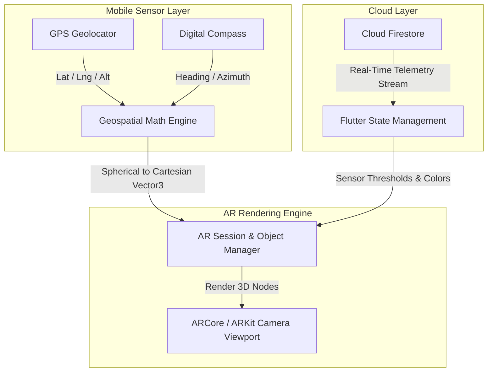

# Project Salamander — Geospatial AR & IoT Digital Twin Platform

[](https://flutter.dev)
[](https://dart.dev)
[](https://developers.google.com/ar)
[](https://firebase.google.com/)
[](LICENSE)

An advanced Augmented Reality (AR) mobile application built with **Flutter** that bridges physical IoT telemetry with 3D spatial computing. **Project Salamander** tracks geographic coordinates, device compass heading, and live cloud telemetry to project real-time, interactive IoT sensor nodes into physical space using Geospatial AR.

---

## 🌟 Key Capabilities

### 📍 1. Geospatial AR & Spatial 3D Projection
- **Real-Time GPS & Compass Fusion:** Ingests high-precision device coordinates (`Geolocator`) and device orientation heading (`FlutterCompass`) to compute relative bearings and distances to physical sensor installations.
- **3D World Anchoring:** Dynamically computes Cartesian coordinates (`Vector3` from `vector_math_64`) and anchors interactive 3D nodes in the AR camera viewport based on spherical Earth trigonometry.
- **AR Session Management:** Built on `ar_flutter_plugin` with support for surface plane detection, camera pose estimation, and raycasting.

### 📡 2. Real-Time IoT Telemetry & Digital Twin
- **Cloud Firestore Synchronization:** Subscribes to real-time telemetry streams from field sensors (temperature, pressure, battery, vibration, status).
- **Dynamic Spatial Status Indicators:** 3D AR node visual attributes (color, scale, altitude offset) update dynamically based on live sensor thresholds (e.g. green for normal, red for critical alerts).
- **CRUD & Sensor Management:** Dedicated management UI to register, edit, calibrate, and simulate field sensor nodes directly from the device.

### 📱 3. Computer Vision & Guided Calibration Flow
- Multi-step scanning progression flow (`_scanProgress`, `_objectScanProgress`) for spatial alignment.
- Visual feature matching simulation to ensure accurate node placement before lock-in.

---

## 🏗️ Architecture & Component Flow



---

## 🛠️ Tech Stack & Dependencies

| Category | Technology |
|---|---|
| **Core Framework** | Flutter 3.x (Dart 3.x) |
| **Augmented Reality** | `ar_flutter_plugin` (Google ARCore & Apple ARKit) |
| **Spatial Math** | `vector_math_64` (Matrix & Vector linear algebra) |
| **Geospatial & Hardware** | `geolocator`, `flutter_compass`, `permission_handler` |
| **Backend & Cloud DB** | Google Firebase (`firebase_core`, `cloud_firestore`) |
| **Architecture** | Reactive Streams (`StreamSubscription`), Clean Service-Model Layer |

---

## 📂 Directory Layout

```
projectSalamander/
├── android/                   # Native Android configuration (ARCore metadata, Camera permissions)
├── ios/                       # Native iOS configuration (ARKit, Camera & Location usage descriptions)
├── assets/                    # 3D models (.gltf, .glb) and texture assets
├── lib/
│   ├── models/
│   │   └── sensor_model.dart  # Sensor data schema (lat, lng, alt, value, status color)
│   ├── services/
│   │   └── firestore_service.dart # Real-time Firestore CRUD & streaming operations
│   ├── screens/
│   │   ├── home_screen.dart   # Main launch hub
│   │   ├── ar_page.dart       # Core AR Camera screen with geospatial positioning engine
│   │   ├── salamander_ar_screen.dart # Secondary AR experiment & method channel bridge
│   │   └── sensor_list_screen.dart   # Interactive sensor inventory & calibration screen
│   └── main.dart              # App initialization & Firebase configuration
└── pubspec.yaml               # Dependencies and asset definitions
```

---

## 🚀 Getting Started

### Prerequisites
- [Flutter SDK](https://docs.flutter.dev/get-started/install) (v3.9+)
- Android device supporting **Google Play Services for AR (ARCore)** OR iOS device supporting **ARKit**.
- Firebase project with Firestore Database enabled.

### Setup Instructions

1. **Clone the repository:**
   ```bash
   git clone https://github.com/Raveloon/projectSalamander.git
   cd projectSalamander
   ```

2. **Install Flutter dependencies:**
   ```bash
   flutter pub get
   ```

3. **Configure Firebase:**
   Add your `google-services.json` to `android/app/` or configure via FlutterFire CLI:
   ```bash
   flutterfire configure
   ```

4. **Run on an AR-capable physical device:**
   ```bash
   flutter run
   ```
   *(Note: AR capabilities require a physical camera and sensors; emulators have limited ARCore simulation).*

---

## 📄 License

This project is licensed under the [MIT License](LICENSE).
